# Mist MPSK Mobile — User Guide

Version 1.3.0

Mist MPSK Mobile is a small web app for creating **Juniper Mist PSKs**: personal Wi-Fi passwords on a multi-PSK network. Every device or visitor can have their own key, which you can see, share as a QR code and delete. It's built for phones: open it in Safari or Chrome and add it to your home screen.

What you see depends on your **role**:

| Role | What it's for |
|---|---|
| **Admin** | Everything: every site, org-level keys, and managing all users |
| **Site admin** | All keys at one site, plus adding guest and self-service users for that site |
| **Guest** | Creating visitor keys at one site (or all sites), on one Wi-Fi network |
| **Self service** | A reception kiosk where visitors create their own key |

> The screenshots use a fictional company, *Acme Retail Ltd*.

---

## 1. Getting started

### Open the app and add it to your home screen

Your admin will give you the address, for example `http://192.168.1.50:5040`.

- **iPhone:** open the address in **Safari**, tap **Share**, then **Add to Home Screen**.
- **Android:** open the address in **Chrome**, tap **⋮**, then **Add to Home screen** (or **Install app**).

Start the app from the new **MPSK** icon. It opens full screen, like any other app. The phone must be on a network that can reach the server, for example the office Wi-Fi or a VPN.

### Sign in

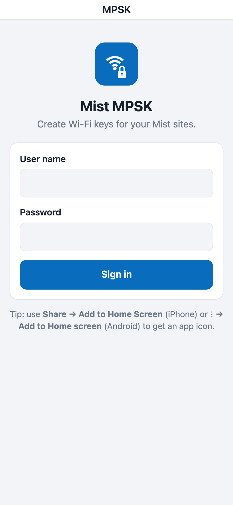 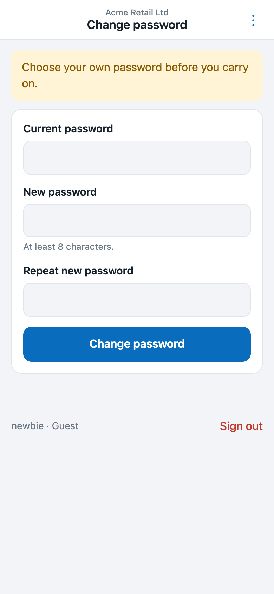

1. Enter the **user name** and **password** your admin gave you.
2. The first time you sign in, you're asked to **choose your own password** (at least 8 characters). Self-service kiosk users skip this step.

You stay signed in for 12 hours after you last used the app. After 5 wrong passwords, that user name is locked out for 15 minutes on that device.

### Moving around

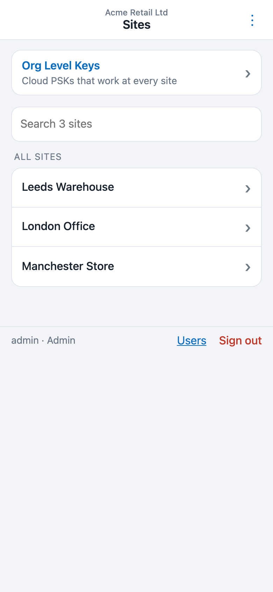 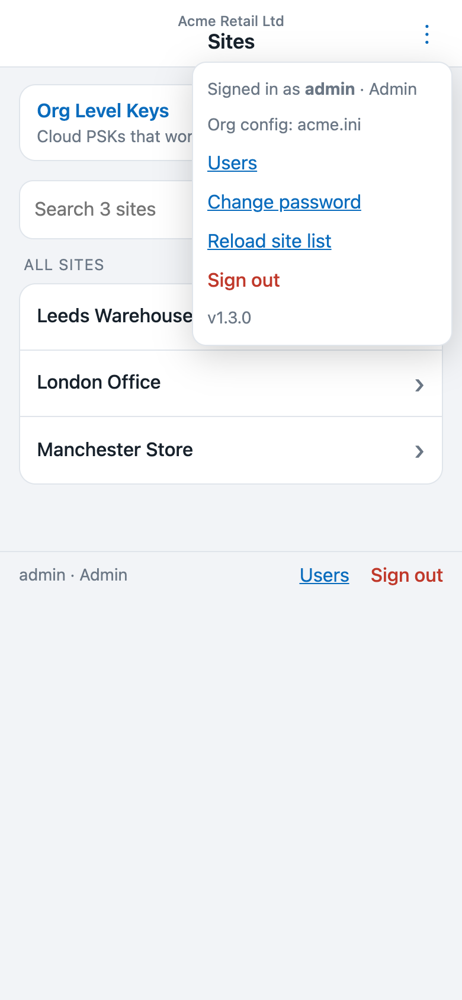

- The **company name** appears above the title on every page.
- **‹** (top left) goes back.
- **⋮** (top right) opens the menu: who you're signed in as, **Change org** (if you have more than one), **Users**, **Change password**, **Reload site list** and **Sign out**.
- The bar at the bottom of every page shows your name and role, with **Users** (admins and site admins) and **Sign out**.

---

## 2. Admins and site admins: managing keys

### Find a site

Admins see the **site list**. Type in **Search** to filter it, or tap a **Recent** site. **Org Level Keys**, at the top of the list, is covered in section 3.

Site admins skip the list and go straight to their own site.

### A site's keys

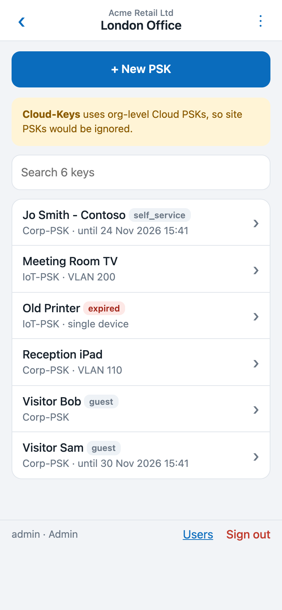

The site page lists every key at the site:

- the **name**, then the **Wi-Fi network (SSID)**, the **VLAN** (if one is set), *single device* if the key is locked to one device, and the expiry time;
- an **expired** tag on keys that no longer work;
- a role tag such as **guest** or **self_service** on keys that guest users or the kiosk created.

Use **Search** to filter by name, SSID, VLAN or role.

A yellow note means the site has a Wi-Fi network this app can't use. For example, a network that uses org-level Cloud PSKs or RADIUS ignores site keys.

### Create a key

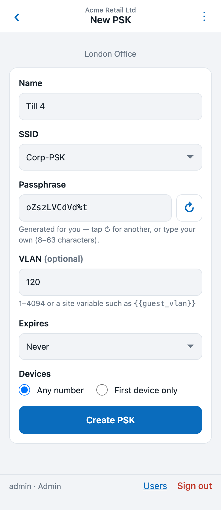

Tap **+ New PSK**, then:

| Field | What to enter |
|---|---|
| **Name** | Who or what the key is for, e.g. *Reception iPad*. Must be unique on that SSID |
| **SSID** | The Wi-Fi network the key works on |
| **Passphrase** | Already generated for you. Tap **↻** for another, or type your own (8–63 characters) |
| **VLAN** | Optional. A number (1–4094) or a site variable such as `{{guest_vlan}}`. Leave it blank to use the network's normal VLAN |
| **Expires** | Never, in 1, 7, 30 or 90 days, or **On a date…** |
| **Devices** | **Any number**, or **First device only** (the key locks to the first device that connects) |

Tap **Create PSK**. The new key opens straight away, ready to share.

### Share a key

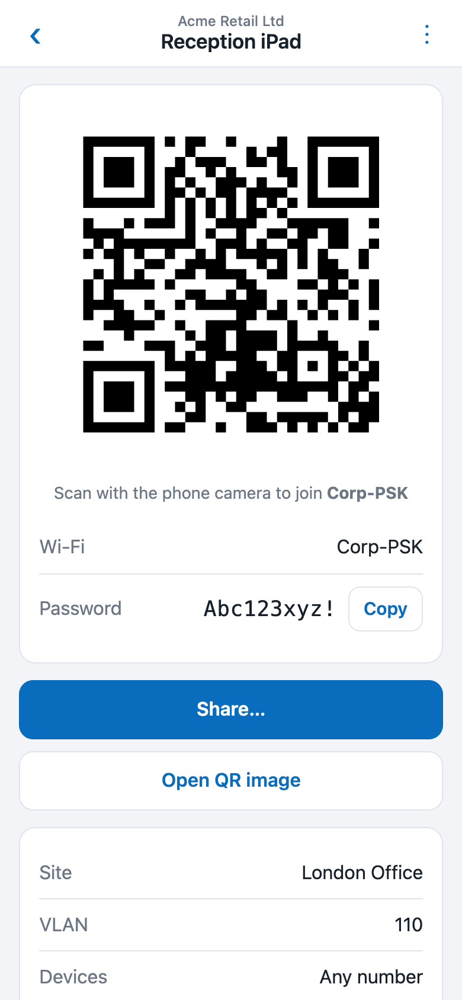 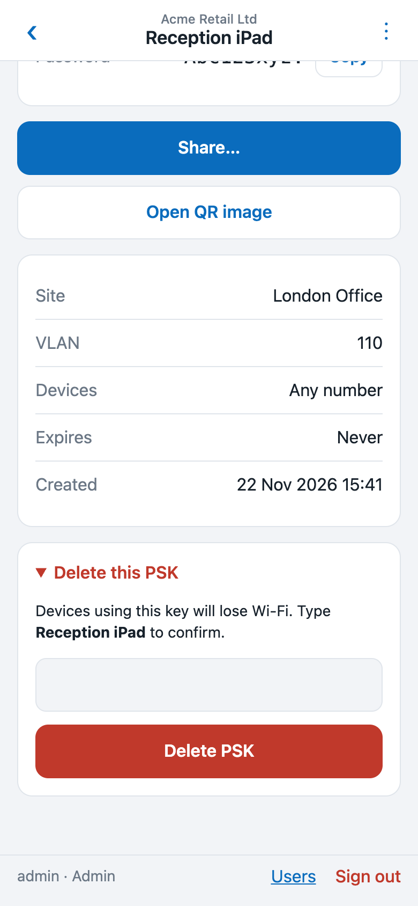

There are three ways to get the key to someone:

- **QR code:** they point their phone camera at the screen and tap the Wi-Fi prompt.
- **Copy:** copies the password.
- **Share…:** sends a picture with the QR code, the Wi-Fi name and the password through Messages, WhatsApp, email and so on. If the browser can't share, the button reads **Copy Wi-Fi details** and copies them as text instead.
- **Open QR image** opens that picture so you can print or save it.

### Delete a key

At the bottom of a key's page, open **Delete this PSK**, type the key's **name** to confirm, and tap **Delete PSK**. Devices using it lose Wi-Fi the next time they reconnect. Guests can't delete keys.

---

## 3. Admins: org-level keys

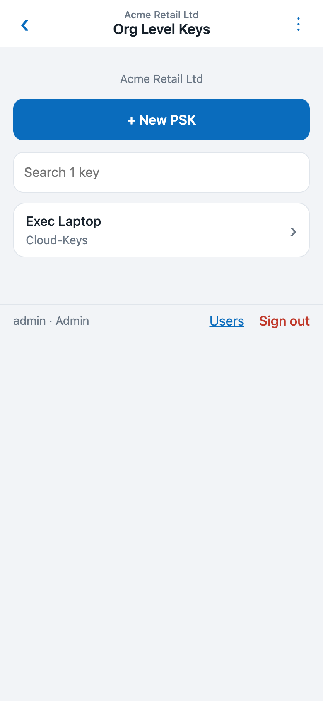

**Org Level Keys**, at the top of the site list, works the same way as a site's keys, but for keys that work at **every site**. Mist calls these *Cloud PSKs*.

- The SSID list only offers networks set to **WPA2/WPA3 Personal with dynamic PSK from Cloud PSKs**. Those are the only networks that read org-level keys.
- If the org has no such network, the page tells you, and **+ New PSK** isn't shown.

---

## 4. Admins and site admins: managing users

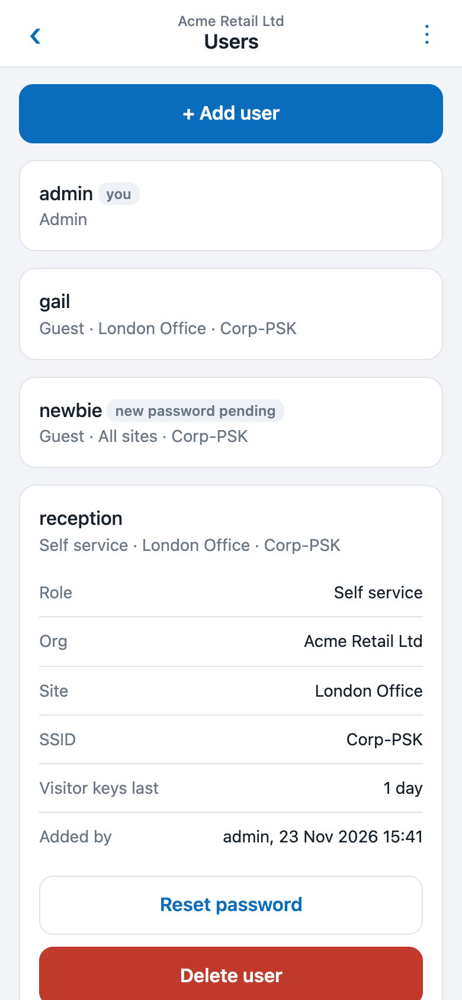 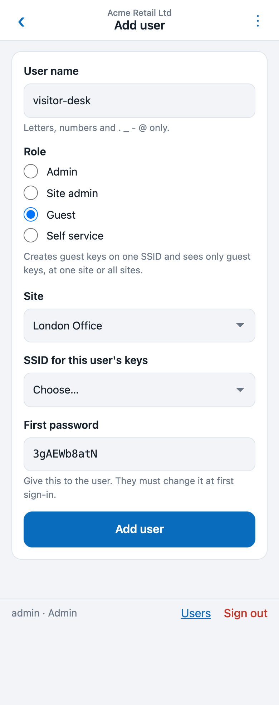

Open **Users** from the bottom bar or the **⋮** menu.

- Tap a user to see their details, then use **Reset password** or **Delete user**.
- **Admins** can manage everyone, but can't delete themselves or the last admin.
- **Site admins** can manage only the guest and self-service users at their own site.

### Add a user

1. Tap **+ Add user** and enter a **user name** (letters, numbers and `. _ - @`).
2. Pick a **role**. A site admin can pick only **Guest** or **Self service**.
3. For any role except admin, choose the **org** (if there's more than one), the **site**, and for guests and self service, the **SSID** their keys use.
    - Guests can have **All sites**. Their SSID list then comes from the org's WLAN templates.
    - For self service, also choose **Visitor keys last** (default 1 day).
4. A **first password** is generated for you. You can change it before you save.
5. Tap **Add user**. The next page shows the user name and password **once**, so pass them on now. Every role except self service must choose their own password at first sign-in.

**Reset password** works the same way: the app generates a new password, shows it once, and the user must change it at their next sign-in (except self-service users).

---

## 5. Guests

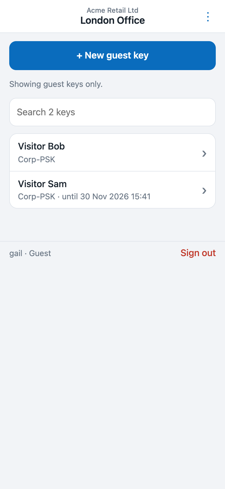 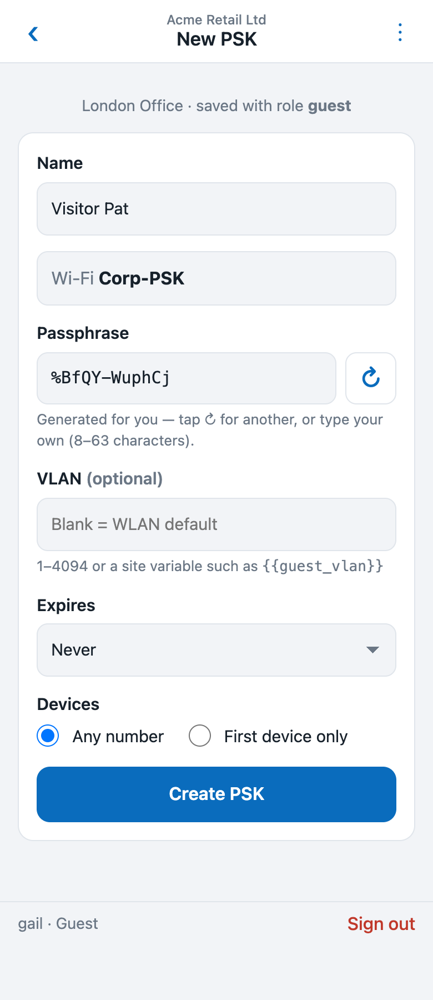

As a guest user, you create keys for visitors:

- You see only **guest keys**, meaning keys that you and other guest users created.
- Tap **+ New guest key**. The **Wi-Fi** network is fixed by your admin, so you only fill in the name, passphrase, optional VLAN, expiry and devices.
- Every key you create is saved in Mist with the role **guest**.
- Share keys the same way as in section 2. You can't delete keys, so ask a site admin or admin to remove one.

If your user covers **all sites**, you pick the site first. If a site doesn't have your Wi-Fi network, the app tells you.

---

## 6. Self-service kiosk

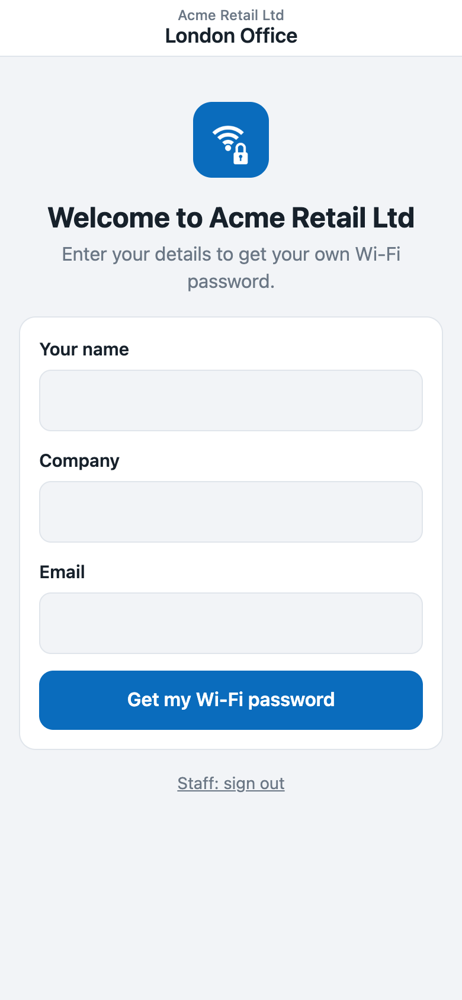 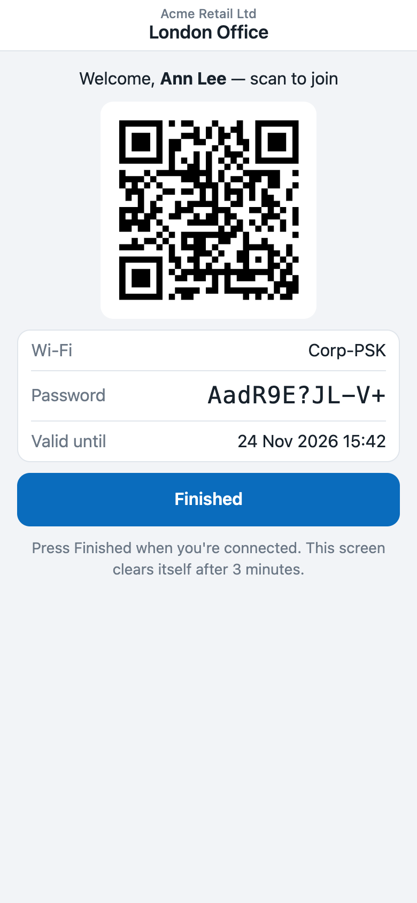

The kiosk is a phone or tablet at reception, signed in as a **self service** user. It shows only a welcome form, so visitors can't reach any other page.

**What a visitor does:**

1. Enters their **name**, **company** and **email**, then taps **Get my Wi-Fi password**.
2. The screen shows a **QR code**, the **Wi-Fi name**, the **password** and when the key **expires**.
3. Scans the QR code with their phone, or types the password, then taps **Finished**.

The screen also clears itself after **3 minutes**, so a key is never left on show.

Behind the scenes, each visitor gets their own key, named *Name - Company* (repeat visitors get *(2)*, *(3)* and so on). The key has the role **self_service**, the visitor's email is saved on it in Mist, and it expires as set for the kiosk user. Admins and site admins can see these keys in the site's list.

### Staff: setting up and signing out the kiosk

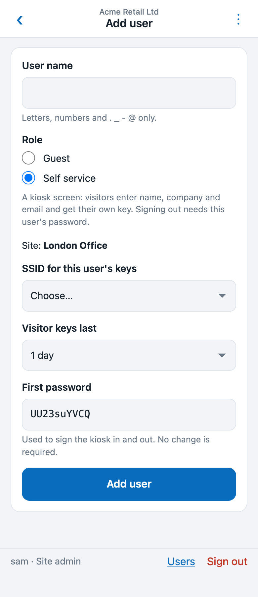 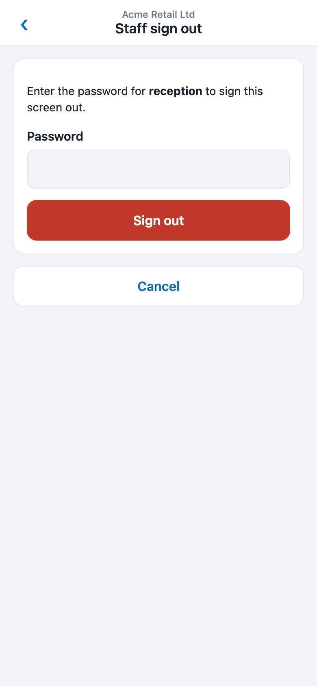

- An admin or site admin adds a **Self service** user, choosing the site, the SSID and how long visitor keys last.
- Sign the tablet in with that user and password, then add the app to the home screen so it opens full screen.
- To sign the kiosk out, tap **Staff: sign out** at the bottom and **enter the user's password again**. Visitors can't sign it out.

---

## 7. Tips and troubleshooting

| Problem | What to do |
|---|---|
| "This form has expired" | Go back, reload the page and try again. This happens after the app has been restarted or your session has ended |
| "No SSID at this site can use site PSKs" | The site needs a WPA2/WPA3 Personal network with **local** multiple passphrases. Ask your Mist admin |
| A key doesn't connect | Check that the phone is joining the **same SSID** the key is for, and that the key hasn't **expired** |
| Locked out after wrong passwords | Wait 15 minutes, or ask an admin to **Reset password** |
| Can't reach the app | Make sure you're on the office Wi-Fi or VPN |

Every sign-in, key created, viewed, shared or deleted, and user change is recorded in the server's activity log. Passwords and Wi-Fi passphrases are never logged.
